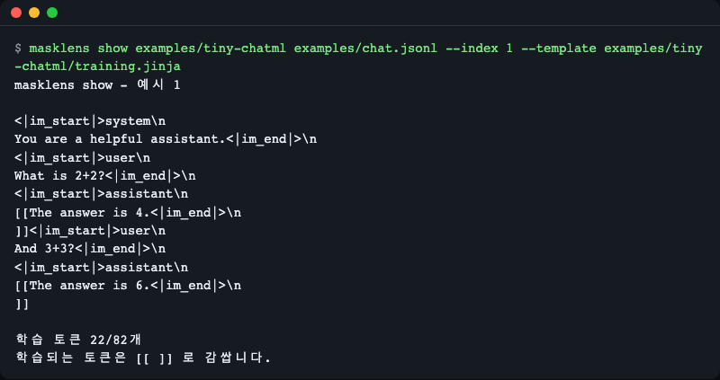
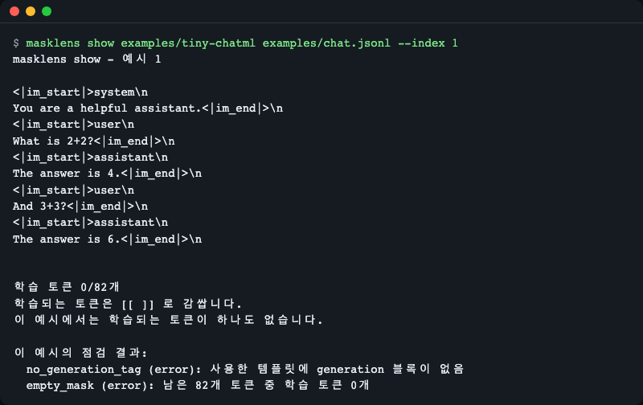
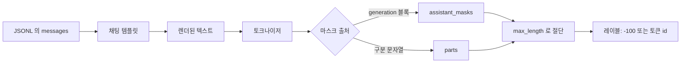
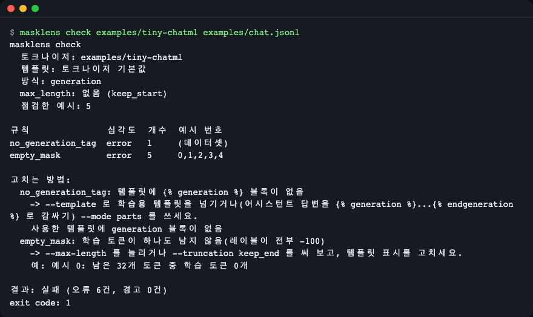
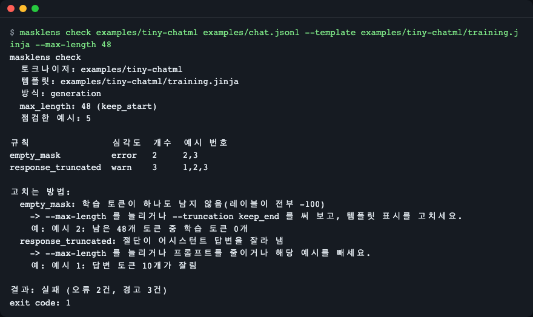
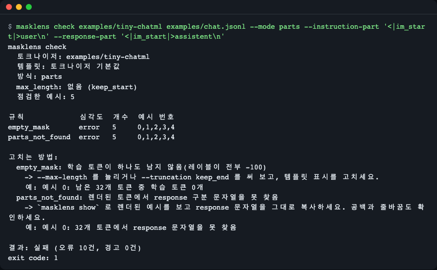
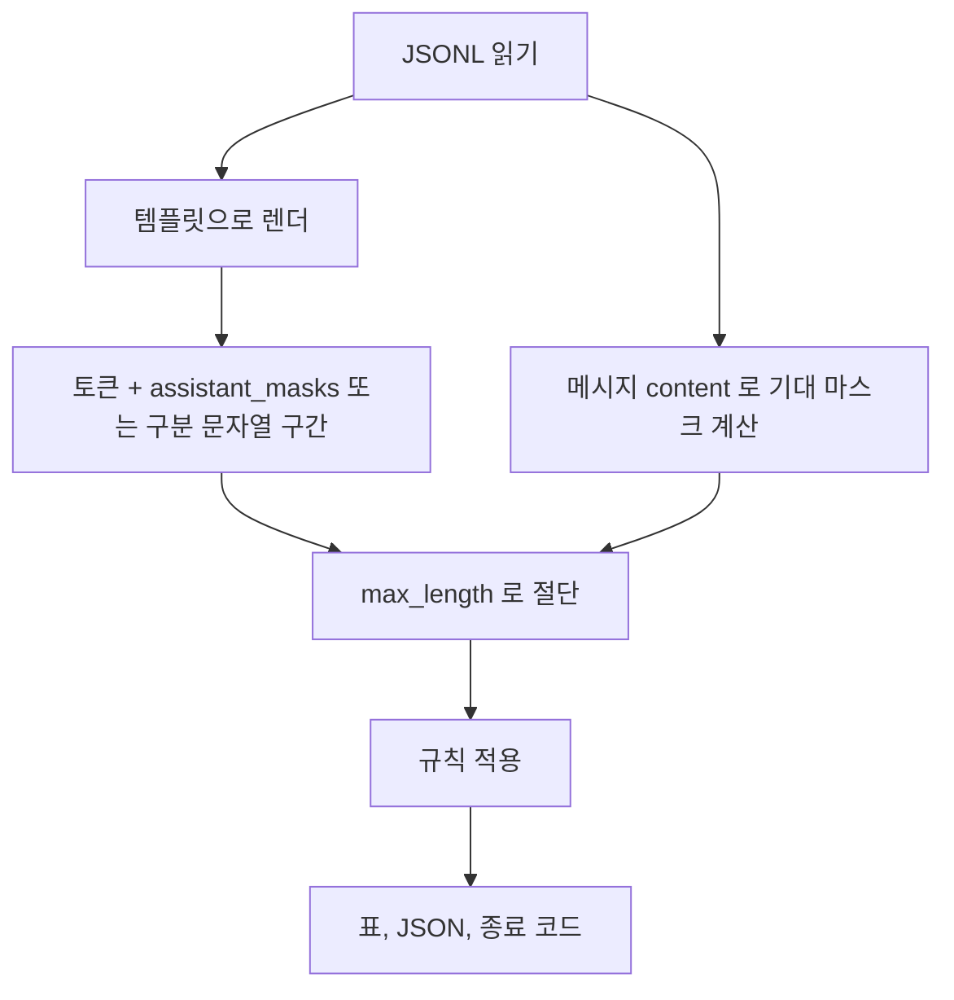

# masklens

[English](README.md) | **한국어**

SFT 손실 마스크 사전 점검 도구: GPU 시간을 쓰기 전에, 채팅 템플릿·토크나이저·레이블이 실제로 어떤 토큰을 학습하는지 확인합니다. 토크나이저만 있으면 되는(모델 가중치·GPU 불필요) 프레임워크 무관 CLI라서 TRL, Unsloth, 직접 짠 학습 루프 어느 쪽에도 똑같이 쓸 수 있습니다.


*`masklens show` 는 학습되는 토큰을 모두 `[[ ]]` 로 감싸 보여 줍니다. 어시스턴트 답변과 그 뒤의 `<|im_end|>` 만 학습됩니다.*

## 이런 분께
- LoRA/SFT 로 채팅 모델을 미세조정하면서, 학습 전에 손실이 답변에만 계산되는지 확인하고 싶은 분
- 학습기가 "all labels are -100" 을 출력했거나 loss 가 움직이지 않아서, 어떤 예시·어떤 템플릿 줄이 원인인지 찾고 싶은 분
- 채팅 템플릿을 직접 고쳐(`` 추가, 머리글 변경 등) 렌더 결과 텍스트가 그대로인지 증명하고 싶은 분
- `max_length` 로 자르는데 답변이 반쯤 잘리거나 통째로 사라진 예시가 있을까 의심되는 분

## 설치
Python 3.11 이상과 [uv](https://docs.astral.sh/uv/) 가 필요합니다.

```bash
curl -LsSf https://astral.sh/uv/install.sh | sh   # uv 설치
git clone https://github.com/LeeGyeongPil/masklens
cd masklens
uv sync
```

이후 명령은 `uv run masklens ...` 로 실행합니다. 최소 리눅스 이미지에는 `git` 과 `curl` 도 필요합니다.

설치 확인은 `uv run masklens --version` 입니다(`masklens 0.1.3` 출력).

아래 명령은 `examples/tiny-chatml/` 의 **연습용 토크나이저**를 씁니다. `scripts/make_tiny_tokenizer.py` 로 만든 시연용 작은 토크나이저(ChatML 형식, 어휘 400개)이며 실제 모델의 토크나이저가 아니라서 토큰 수가 실제와 다릅니다. 실제 작업에서는 모델의 토크나이저 폴더나 Hub ID 를 넘기세요. 테스트는 아무것도 내려받지 않습니다.

## 빠르게 시작하기
```bash
uv run masklens show examples/tiny-chatml examples/chat.jsonl --index 1
```
```text
masklens show - example 1

<|im_start|>system\n
You are a helpful assistant.<|im_end|>\n
<|im_start|>user\n
What is 2+2?<|im_end|>\n
<|im_start|>assistant\n
The answer is 4.<|im_end|>\n
<|im_start|>user\n
And 3+3?<|im_end|>\n
<|im_start|>assistant\n
The answer is 6.<|im_end|>\n


trained 0/82 tokens
Trained tokens are wrapped in [[ ]].
No token is trained in this example.

Findings for this example:
  no_generation_tag (error): the template used has no generation block
  empty_mask (error): 0 of 82 kept tokens are trained
```

(위는 영어 화면입니다. 시스템 언어가 한국어면 옵션 없이도 한국어 화면이 나오고, 위와 같은 영어 화면은 `--lang en` 으로 볼 수 있습니다.) 강조된 곳이 하나도 없습니다. 토크나이저 기본 템플릿에 `` 블록이 없어서 "어시스턴트 토큰만" 마스크가 비어 있기 때문입니다. transformers 같은 라이브러리는 이때 오류를 내지 않고, 레이블이 조용히 전부 `-100` 이 됩니다.


*원본 템플릿: 82개 토큰 중 0개 학습.*

이제 어시스턴트 답변을 표시한 학습용 템플릿을 넘겨 봅니다.

```bash
uv run masklens show examples/tiny-chatml examples/chat.jsonl --index 1 --template examples/tiny-chatml/training.jinja
```
```text
masklens show - example 1

<|im_start|>system\n
You are a helpful assistant.<|im_end|>\n
<|im_start|>user\n
What is 2+2?<|im_end|>\n
<|im_start|>assistant\n
[[The answer is 4.<|im_end|>\n
]]<|im_start|>user\n
And 3+3?<|im_end|>\n
<|im_start|>assistant\n
[[The answer is 6.<|im_end|>\n
]]

trained 22/82 tokens
Trained tokens are wrapped in [[ ]].
```

두 답변과 그 종료 토큰(82개 중 22개)만 학습됩니다. 대화형 터미널에서는 같은 토큰이 색으로 표시되고, `--no-color` 를 쓰거나 출력을 파이프로 넘기면 위처럼 `[[ ]]` 로 표시됩니다.

## 마스크가 깨지는 이유
레이블을 시험지에 덮는 채점 필름이라고 생각해 보세요. `-100` 은 가려진 자리(손실이 무시함), 그 밖의 id 는 뚫린 구멍(모델이 채점받는 곳)입니다. 채팅 데이터에서는 구멍이 어시스턴트 답변 위에만 있어야 합니다. 구멍의 위치는 세 가지가 정합니다.



- **템플릿**: 템플릿이 메시지를 텍스트로 렌더합니다. 답변을 `` ... `` 로 감싸면 transformers 가 어느 토큰이 답변에서 왔는지 알려 줍니다. 표시가 없으면 마스크는 전부 0입니다.
- **구분 문자열**(`parts` 모드, Unsloth 의 응답만 학습 방식): 표시 대신 사용자 턴이 시작되는 문자열과 어시스턴트 턴이 시작되는 문자열을 직접 줍니다. 오타가 있으면 아무것도 일치하지 않습니다.
- **절단**: `max_length` 로 자르면 답변의 끝이나 전체가 사라질 수 있습니다.

masklens 는 마스크를 계산하고, 절단을 적용한 뒤, 결과를 규칙으로 점검합니다.

## 사용법
| 명령·옵션 | 하는 일 | 예 |
|---|---|---|
| `masklens show TOKENIZER DATA` | 예시 하나에서 학습 토큰을 강조해 보여 줌 | `--index 1` |
| `masklens check TOKENIZER DATA` | 모든 예시를 규칙으로 점검 | `--limit 100` |
| `--template FILE` | 토크나이저 기본 대신 Jinja 채팅 템플릿 파일 사용 | `--template training.jinja` |
| `--mode generation\|parts` | 마스크 출처: `` 블록 또는 구분 문자열 | `--mode parts` |
| `--instruction-part`, `--response-part` | `parts` 모드의 구분 문자열(`\n` 은 개행으로 바뀜) | `--response-part '<\|im_start\|>assistant\n'` |
| `--max-length N`, `--truncation keep_start\|keep_end` | 마스크를 판정하기 전에 학습기처럼 자름 | `--max-length 48` |
| `--field NAME` | 메시지 목록이 든 JSON 키(기본 `messages`) | `--field conversations` |
| `--index I` | (`show`) 보여 줄 예시 번호(0부터) | `--index 1` |
| `--no-color` | (`show`) ANSI 색 없이 학습 토큰을 `[[ ]]` 로만 표시 | `--no-color` |
| `--limit N` | (`check`) 앞의 N개 예시만 점검 | `--limit 100` |
| `--json` | 표 대신 기계가 읽는 보고서 출력 | `--json > report.json` |
| `--strict` | 경고도 실패로 처리 | `--strict` |
| `--lang en\|ko` | 화면 언어 | `--lang ko` |

`TOKENIZER` 는 `AutoTokenizer.from_pretrained` 가 받는 값(폴더 또는 Hub ID), `DATA` 는 한 줄에 `{"messages": [...]}` 하나인 JSONL 파일입니다. 종료 코드(`check`): `0` 문제 없음, `1` 문제 발견, `2` 입력 오류(UTF-8 텍스트가 아닌 파일 포함, UTF-8 로 저장하세요). `show` 는 예시 하나를 보여 줄 뿐이라 문제를 보고해도 `0` 으로 끝나고, 입력 오류일 때만 `2` 입니다.

### 원본 템플릿으로 데이터셋 점검
```bash
uv run masklens check examples/tiny-chatml examples/chat.jsonl
```
```text
masklens check
  tokenizer: examples/tiny-chatml
  template: tokenizer's own
  mode: generation
  max_length: none (keep_start)
  examples checked: 5

RULE               SEVERITY  COUNT  EXAMPLES
no_generation_tag  error     1      (dataset)
empty_mask         error     5      0,1,2,3,4

How to fix:
  no_generation_tag: Template has no  block
    -> Pass a training template with --template (wrap the assistant answer in ...) or use --mode parts.
    the template used has no generation block
  empty_mask: No trained token left (all labels would be -100)
    -> Raise --max-length, try --truncation keep_end, or fix the template markers.
    e.g. example 0: 0 of 32 kept tokens are trained

Result: FAIL (6 error(s), 0 warning(s))
```
학습 전에 "all labels are -100" 상황을 미리 찾았습니다. 종료 코드는 1입니다. 같은 명령에 `--lang ko` 를 붙이면 화면이 한국어로 나옵니다.


*요약 표와 고치는 방법(한국어 화면).*

학습용 템플릿을 쓰면 같은 점검이 통과합니다.
```bash
uv run masklens check examples/tiny-chatml examples/chat.jsonl --template examples/tiny-chatml/training.jinja
```
```text
masklens check
  tokenizer: examples/tiny-chatml
  template: examples/tiny-chatml/training.jinja
  mode: generation
  max_length: none (keep_start)
  examples checked: 5

No findings.

Result: PASS
```

### 절단 영향 보기
```bash
uv run masklens check examples/tiny-chatml examples/chat.jsonl --template examples/tiny-chatml/training.jinja --max-length 48
```
```text
masklens check
  tokenizer: examples/tiny-chatml
  template: examples/tiny-chatml/training.jinja
  mode: generation
  max_length: 48 (keep_start)
  examples checked: 5

RULE                SEVERITY  COUNT  EXAMPLES
empty_mask          error     2      2,3
response_truncated  warn      3      1,2,3

How to fix:
  empty_mask: No trained token left (all labels would be -100)
    -> Raise --max-length, try --truncation keep_end, or fix the template markers.
    e.g. example 2: 0 of 48 kept tokens are trained
  response_truncated: Truncation cut into the assistant answer
    -> Raise --max-length, shorten the prompts, or drop these examples.
    e.g. example 1: 10 answer token(s) cut off

Result: FAIL (2 error(s), 3 warning(s))
```
48토큰으로 자르면 예시 2, 3 은 답변 토큰을 전부 잃고 예시 1 은 답변 일부를 잃습니다. `--truncation keep_end`(앞쪽 대신 뒤쪽 토큰을 남김)를 붙이면 이 데이터에서는 `No findings.` 가 나옵니다.


*`response_truncated` 와 `empty_mask`, 해당 예시 번호.*

### 구분 문자열(Unsloth 식 `parts` 모드)
```bash
uv run masklens check examples/tiny-chatml examples/chat.jsonl --mode parts --instruction-part '<|im_start|>user\n' --response-part '<|im_start|>assistant\n'
```
결과는 `No findings.` / `Result: PASS` 입니다. `--response-part` 에 오타(`assistent`)가 있으면:
```bash
uv run masklens check examples/tiny-chatml examples/chat.jsonl --mode parts --instruction-part '<|im_start|>user\n' --response-part '<|im_start|>assistent\n'
```
```text
RULE             SEVERITY  COUNT  EXAMPLES
empty_mask       error     5      0,1,2,3,4
parts_not_found  error     5      0,1,2,3,4
```
(머리 줄과 고치는 방법은 줄였습니다. 전체 출력 끝은 `Result: FAIL (10 error(s), 0 warning(s))` 입니다.)


*틀린 `--response-part` 는 `parts_not_found` 로 보고됩니다.*

### 규칙
| 규칙 | 심각도 | 뜻 | 고치는 법 |
|---|---|---|---|
| `no_generation_tag` | error | 템플릿에 `` 블록이 없음(데이터셋 전체) | `--template` 으로 학습용 템플릿을 쓰거나 `--mode parts` |
| `empty_mask` | error | 예시에 학습 토큰이 하나도 없음(전부 `-100`) | 표시 고치기, `--max-length` 늘리기, `keep_end` 시도 |
| `prompt_leak` | error | system/user/tool 텍스트가 학습됨 | generation 블록이 어시스턴트 content 만 덮게 하기 |
| `render_mismatch` | error | 내 템플릿이 토크나이저 기본과 다른 텍스트를 렌더함(보고서가 처음 다른 글자 위치를 알려 줌) | `` 표시만 바꾸기 |
| `parts_not_found` | error | 구분 문자열이 렌더된 토큰에서 발견되지 않음 | `masklens show` 출력에서 문자열 복사 |
| `response_truncated` | warn | 절단이 답변을 침범함 | `--max-length` 늘리기, 프롬프트 줄이기, 예시 제외 |
| `untrained_turn` | warn | 어시스턴트 턴 하나가 전혀 학습되지 않음 | 그 턴의 표시 확인 |
| `eos_not_trained` | warn | 답변 뒤 턴 종료 토큰이 학습되지 않음 | 종료 토큰을 generation 블록 안에 넣어 모델이 멈추는 법을 배우게 하기 |
| `content_not_found` | warn | 메시지 텍스트를 그대로 찾지 못함(템플릿이 content 를 변형), 그 메시지는 교차 확인에서 제외 | 참고용 |

`render_mismatch` 는 `--template` 을 줄 때만 검사합니다. 시연: `--template tests/fixtures/leaky.jinja` 는 모든 턴을 학습하는 템플릿이라 예시 5개 전부에서 `prompt_leak` 와 `eos_not_trained` 를 보고합니다.

## 설정
| 설정 | 뜻 |
|---|---|
| `--lang en\|ko` | 화면 언어. 우선순위: `--lang`, `MASKLENS_LANG`, `LC_ALL`·`LC_MESSAGES`·`LANG` 순이며 한국어가 아니면 영어. 규칙 ID 와 JSON 키는 번역하지 않습니다. |
| `MASKLENS_LANG` | `en` 또는 `ko` |
| `HF_HUB_OFFLINE=1` | Hugging Face 표준 설정. 로컬 토크나이저 폴더가 네트워크를 쓰지 않게 합니다 |
| `MASKLENS_REAL_TOK_DIR` | 레포의 추가 테스트용 실제 토크나이저 폴더(선택, 없으면 건너뜀) |

한국어 화면: `uv run masklens check examples/tiny-chatml examples/chat.jsonl --lang ko`.

## 동작 원리

1. 메시지를 템플릿으로 렌더하고 토큰화합니다.
2. 마스크는 ``(`assistant_masks`) 또는 구분 문자열에서 구합니다.
3. 따로, 어시스턴트 `content` 의 문자 구간(+ 턴 종료 토큰)으로 "기대 마스크"를 계산합니다. 학습용 템플릿이 올바르면 두 마스크가 토큰 단위로 같고, 다르면 `prompt_leak`, `eos_not_trained` 등으로 나타납니다.
4. 절단은 masklens 가 직접 하므로(`keep_start` 또는 `keep_end`) 결과가 학습기 옵션에 좌우되지 않습니다.
5. 규칙이 최종 마스크를 결과 목록·표·JSON 보고서·종료 코드로 바꿉니다.

## 학습용 템플릿 쓰기
어시스턴트 분기를 `` 로 감쌉니다. 연습용 템플릿이 이렇게 합니다(여러 줄로 풀어 쓴 모양).
```jinja

  
    {{- '<|im_start|>assistant\n' }}
    {{- message.content + '<|im_end|>' + '\n' }}
  
    {{- '<|im_start|>' + message.role + '\n' + message.content + '<|im_end|>' + '\n' }}
  

```
역할 머리글(`<|im_start|>assistant\n`)은 블록 밖이라 학습되지 않고, 답변·종료 토큰·끝 개행은 블록 안입니다. 실제 템플릿 중에는 머리글까지 학습하는 것도 있는데, 이는 오류가 아니라 정책 선택입니다. `masklens check ... --template your.jinja` 로 선택의 결과를 보고, 토크나이저 기본 출력과의 동등성 검사(`render_mismatch`)로 텍스트 자체가 바뀌지 않았는지 확인하세요.

## 학습기와 함께 쓰기
- **TRL `SFTTrainer`** 의 `assistant_only_loss=True` 는 템플릿에 `` 표시가 필요합니다. 학습기에 주는 템플릿으로 기본 `--mode generation` 을 쓰세요.
- **Unsloth** `train_on_responses_only`: 같은 instruction·response 문자열로 `--mode parts` 를 쓰세요.
- **직접 짠 루프**: collator 에서 쓰는 `max_length` 와 절단 방향을 그대로 넘기세요.

## CI
`--json` 은 `versions`, `mode`, `max_length`, `summary.by_rule`, `findings[]` 가 든 보고서를 씁니다. 종료 코드는 `0` 깨끗, `1` 오류(`--strict` 면 경고도), `2` 입력 오류입니다.
```bash
uv run masklens check examples/tiny-chatml examples/chat.jsonl --template examples/tiny-chatml/training.jinja --json
```
```json
{
  "versions": {
    "masklens": "0.1.3",
    "transformers": "5.24.0",
    "tokenizers": "0.23.3"
  },
  "tokenizer": "examples/tiny-chatml",
  "template": "examples/tiny-chatml/training.jinja",
  "mode": "generation",
  "max_length": null,
  "truncation": "keep_start",
  "examples": 5,
  "summary": {
    "errors": 0,
    "warnings": 0,
    "by_rule": {},
    "exit_code": 0
  },
  "findings": []
}
```

## 언제 쓰나
- 이럴 때: 실제로 쓰는 템플릿·절단 설정으로 학습 전에 데이터셋 전체의 손실 마스크를 프레임워크와 무관하게 빠르게 확인하고 싶을 때
- 이럴 땐 다른 도구: 특정 학습 파이프라인 안의 레이블을 보려면 [axolotl](https://github.com/axolotl-ai-cloud/axolotl) 의 디버그 출력이나 [TRL](https://huggingface.co/docs/trl/sft_trainer)·[Unsloth](https://unsloth.ai/docs) 문서를 보세요. masklens 는 학습을 실행하지 않습니다.

### 한계

템플릿을 고쳐 쓰지 않고, 채팅 메시지만 다룹니다(도구 호출·think 블록 규칙은 아직 없음). 템플릿이 메시지 content 를 변형(공백 제거, think 블록 제거)하면 그 메시지는 교차 확인할 수 없습니다(`content_not_found`). 메시지 텍스트가 `user` 같은 역할 이름과 똑같으면 문자 구간이 틀리게 잡힐 수 있습니다. 마스크 동작은 transformers 버전에 따라 다릅니다(여기서는 5.24.0 사용, `>=5.24.0,<6` 허용). 레포 테스트는 연습용 토크나이저를 쓰며, 실제 Qwen2.5·SmolLM3 토크나이저는 테스트 모음에서 돌려 보지 않았습니다.

## 자주 겪는 문제
| 증상 | 원인 | 해결 |
|---|---|---|
| 모든 예시에 `no_generation_tag` + `empty_mask` | 템플릿에 `` 블록이 없음 | `--template` 으로 학습용 템플릿을 쓰거나 `--mode parts` |
| `parts_not_found` | 구분 문자열이 렌더된 텍스트와 다름(공백·개행·오타) | `masklens show` 에서 복사. 셸에서는 개행을 `\n` 으로 적기 |
| `unrecognized arguments: --no-color` | `--no-color` 는 `show` 에만 있음 | `check` 에서는 빼기(색이 없는 출력) |
| Hub 다운로드 오류, 첫 실행이 느림 | 원격 토크나이저를 받는 중 | 로컬 폴더와 `HF_HUB_OFFLINE=1` 사용, 먼저 `--limit N` 으로 일부만 |
| 종료 코드 2 | 입력 오류(깨진 JSONL, 없는 파일) | 메시지에 줄 번호가 나옴 |

## 개발·기여
```bash
HF_HUB_OFFLINE=1 uv run pytest -q
```
버그·제안은 이슈로 남겨 주세요. 변경 기록은 [CHANGELOG.md](CHANGELOG.md).

## 라이선스
MIT. `examples/tiny-chatml/` 의 연습용 토크나이저는 이 레포의 스크립트로 생성했으며 외부 모델 데이터를 담고 있지 않습니다.
