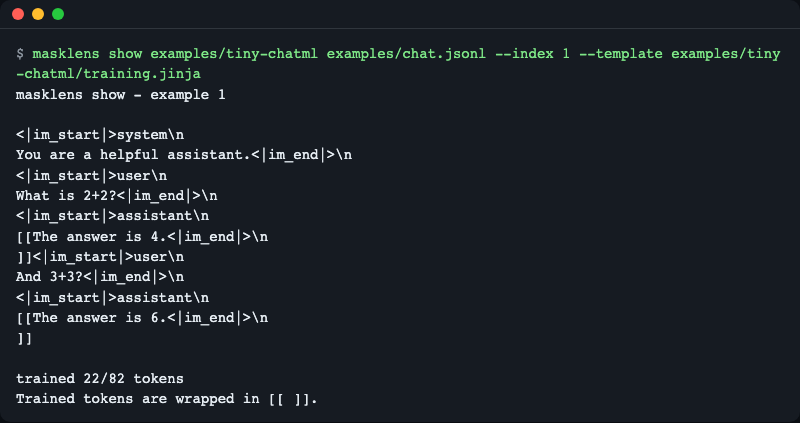
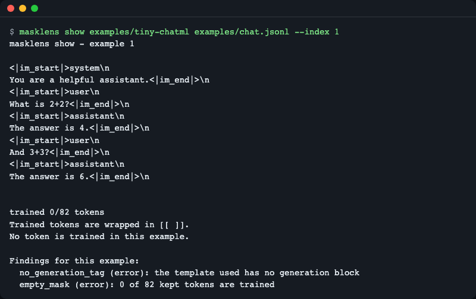
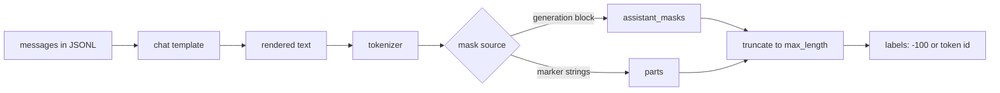
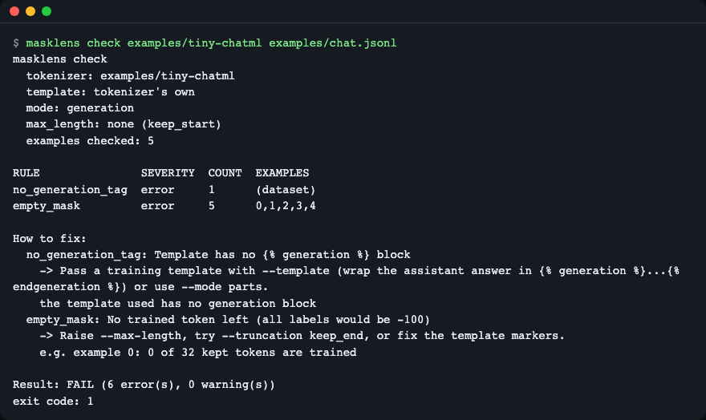
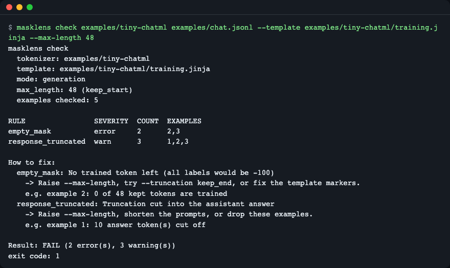
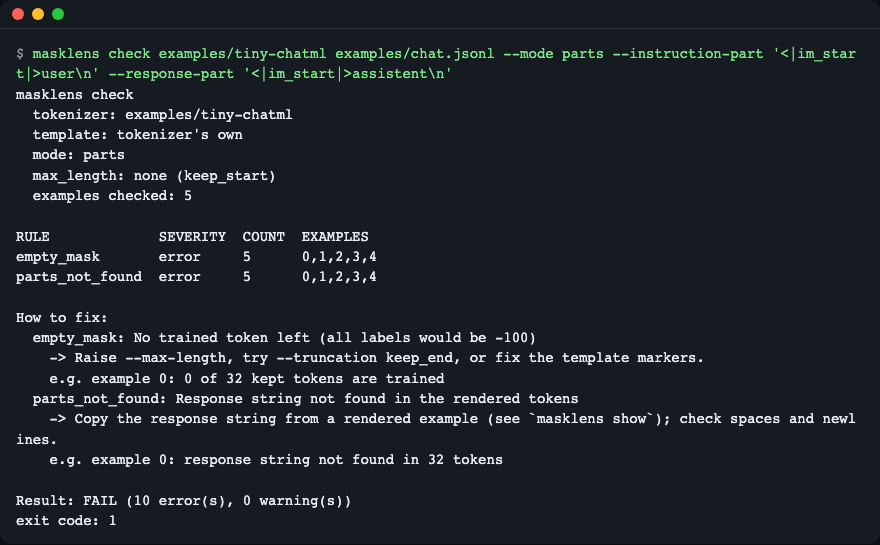
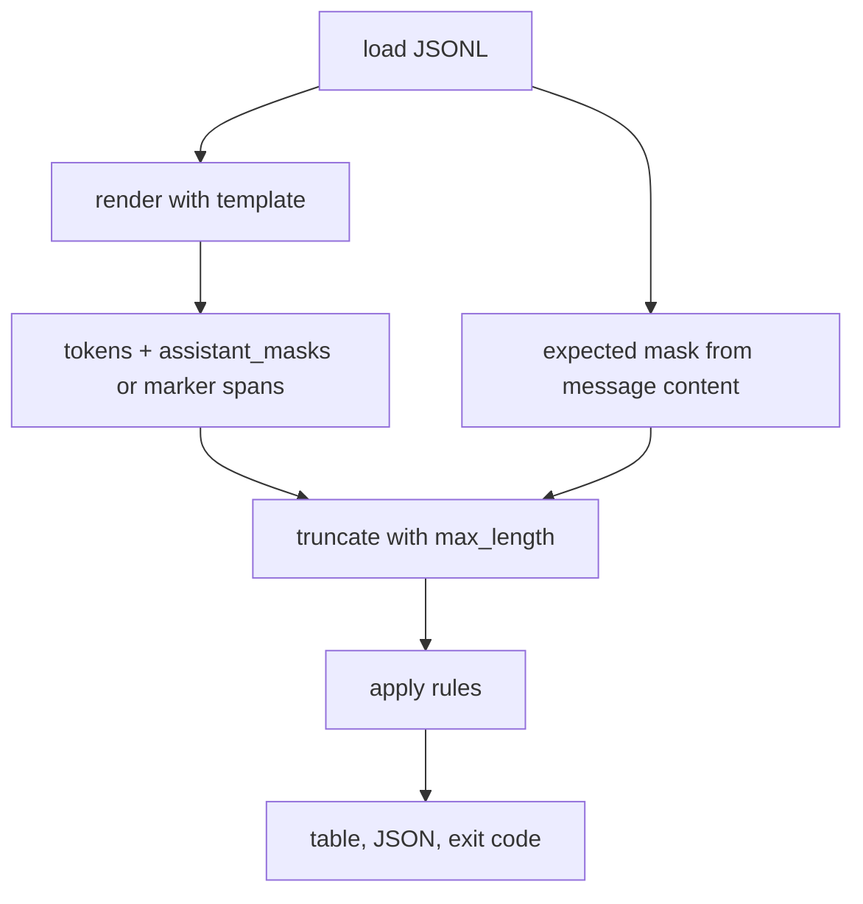

# masklens

**English** | [한국어](README.ko.md)

Preflight check for SFT loss masks: before you spend GPU time, see which tokens your chat template, tokenizer and labels will actually train on. It is a framework-independent CLI that needs only a tokenizer (no model weights, no GPU), and it works the same whether you train with TRL, Unsloth or your own loop.


*`masklens show` wraps every trained token in `[[ ]]`: only the assistant answers and their `<|im_end|>` are trained.*

## Who is this for
- You fine-tune a chat model with LoRA/SFT and want to know, before the run, that the loss is computed on the answers only.
- Your trainer printed "all labels are -100" (or the loss never moved) and you want to find out which example or which template line causes it.
- You edited a chat template by hand (added ``, changed a header) and want proof that it still renders exactly the same text.
- You truncate with `max_length` and suspect that some answers are cut in half or cut away completely.

## Install
Python 3.11 or newer and [uv](https://docs.astral.sh/uv/) are required.

```bash
curl -LsSf https://astral.sh/uv/install.sh | sh   # installs uv
git clone https://github.com/LeeGyeongPil/masklens
cd masklens
uv sync
```

Then run commands with `uv run masklens ...`. On a minimal Linux image you also need `git` and `curl`.

The commands below use the **practice tokenizer** in `examples/tiny-chatml/`. It is a tiny tokenizer built by `scripts/make_tiny_tokenizer.py` for demonstration (a ChatML-style vocabulary of 400 entries). It is not the tokenizer of a real model, so token counts differ from a real one. For real work, pass your model's tokenizer folder or Hub ID instead. The tests do not download anything.

Check the install with `uv run masklens --version` (prints `masklens 0.1.3`).

## Quick start
```bash
uv run masklens show examples/tiny-chatml examples/chat.jsonl --index 1
```
The output language follows your system locale; add `--lang en` to match the outputs shown here.

```text
masklens show - example 1

<|im_start|>system\n
You are a helpful assistant.<|im_end|>\n
<|im_start|>user\n
What is 2+2?<|im_end|>\n
<|im_start|>assistant\n
The answer is 4.<|im_end|>\n
<|im_start|>user\n
And 3+3?<|im_end|>\n
<|im_start|>assistant\n
The answer is 6.<|im_end|>\n


trained 0/82 tokens
Trained tokens are wrapped in [[ ]].
No token is trained in this example.

Findings for this example:
  no_generation_tag (error): the template used has no generation block
  empty_mask (error): 0 of 82 kept tokens are trained
```

Nothing is highlighted: the tokenizer's own template has no `` block, so the "assistant tokens only" mask is empty. Libraries such as transformers do not raise an error in this case; the labels are silently all `-100`.


*Original template: 0 of 82 tokens are trained.*

Now pass a training template that marks the assistant answer:

```bash
uv run masklens show examples/tiny-chatml examples/chat.jsonl --index 1 --template examples/tiny-chatml/training.jinja
```
```text
masklens show - example 1

<|im_start|>system\n
You are a helpful assistant.<|im_end|>\n
<|im_start|>user\n
What is 2+2?<|im_end|>\n
<|im_start|>assistant\n
[[The answer is 4.<|im_end|>\n
]]<|im_start|>user\n
And 3+3?<|im_end|>\n
<|im_start|>assistant\n
[[The answer is 6.<|im_end|>\n
]]

trained 22/82 tokens
Trained tokens are wrapped in [[ ]].
```

Only the two answers and their end token (22 of 82 tokens) are trained. In an interactive terminal the same tokens are shown in color; the `[[ ]]` form is used with `--no-color` or when the output is piped (as in the outputs above).

## Why masks break
Think of the labels as a marking film laid over an exam sheet: `-100` is a covered spot (ignored by the loss), and every other id is a hole where the model is graded. For chat data you want holes only over the assistant answers. Three things decide where the holes are:



- **Template**: the template renders messages to text. With `` ... `` around the answer, transformers can report which tokens came from it. Without the tags, the mask is all zeros.
- **Marker strings** (the `parts` mode, as in Unsloth's response-only training): instead of tags, you give the text that starts a user turn and the text that starts an assistant turn. A typo means nothing matches.
- **Truncation**: cutting to `max_length` can remove the end of an answer, or all of it.

masklens computes the mask, applies your truncation, and checks the result against rules.

## Usage
| Command / option | What it does | Example |
|---|---|---|
| `masklens show TOKENIZER DATA` | Show one example with trained tokens highlighted | `--index 1` |
| `masklens check TOKENIZER DATA` | Check every example against the rules | `--limit 100` |
| `--template FILE` | Use a Jinja chat template file instead of the tokenizer's own | `--template training.jinja` |
| `--mode generation\|parts` | Mask source: `` blocks or marker strings | `--mode parts` |
| `--instruction-part`, `--response-part` | Marker strings for `parts` mode (`\n` is turned into a newline) | `--response-part '<\|im_start\|>assistant\n'` |
| `--max-length N`, `--truncation keep_start\|keep_end` | Truncate like your trainer before judging the mask | `--max-length 48` |
| `--field NAME` | JSON key that holds the message list (default `messages`) | `--field conversations` |
| `--index I` | (`show`) Which example to show, counting from 0 | `--index 1` |
| `--no-color` | (`show`) No ANSI colors, trained tokens only in `[[ ]]` | `--no-color` |
| `--limit N` | (`check`) Check only the first N examples | `--limit 100` |
| `--json` | Print a machine-readable report instead of the table | `--json > report.json` |
| `--strict` | Treat warnings as failures | `--strict` |
| `--lang en\|ko` | Screen language | `--lang ko` |

`TOKENIZER` is anything `AutoTokenizer.from_pretrained` accepts (a folder or a Hub ID). `DATA` is a JSONL file with one `{"messages": [...]}` per line. Exit codes (`check`): `0` no problem, `1` problem found, `2` input error (including a file that is not UTF-8 text; save it as UTF-8). `show` only inspects one example: it exits `0` even when it reports problems, and `2` on input errors.

### Check a dataset with the original template
```bash
uv run masklens check examples/tiny-chatml examples/chat.jsonl
```
```text
masklens check
  tokenizer: examples/tiny-chatml
  template: tokenizer's own
  mode: generation
  max_length: none (keep_start)
  examples checked: 5

RULE               SEVERITY  COUNT  EXAMPLES
no_generation_tag  error     1      (dataset)
empty_mask         error     5      0,1,2,3,4

How to fix:
  no_generation_tag: Template has no  block
    -> Pass a training template with --template (wrap the assistant answer in ...) or use --mode parts.
    the template used has no generation block
  empty_mask: No trained token left (all labels would be -100)
    -> Raise --max-length, try --truncation keep_end, or fix the template markers.
    e.g. example 0: 0 of 32 kept tokens are trained

Result: FAIL (6 error(s), 0 warning(s))
```
This is the "all labels are -100" situation, found before training. The exit code is 1.


*Summary table plus the fix hints.*

With the training template the same check passes:
```bash
uv run masklens check examples/tiny-chatml examples/chat.jsonl --template examples/tiny-chatml/training.jinja
```
```text
masklens check
  tokenizer: examples/tiny-chatml
  template: examples/tiny-chatml/training.jinja
  mode: generation
  max_length: none (keep_start)
  examples checked: 5

No findings.

Result: PASS
```

### See what truncation does
```bash
uv run masklens check examples/tiny-chatml examples/chat.jsonl --template examples/tiny-chatml/training.jinja --max-length 48
```
```text
masklens check
  tokenizer: examples/tiny-chatml
  template: examples/tiny-chatml/training.jinja
  mode: generation
  max_length: 48 (keep_start)
  examples checked: 5

RULE                SEVERITY  COUNT  EXAMPLES
empty_mask          error     2      2,3
response_truncated  warn      3      1,2,3

How to fix:
  empty_mask: No trained token left (all labels would be -100)
    -> Raise --max-length, try --truncation keep_end, or fix the template markers.
    e.g. example 2: 0 of 48 kept tokens are trained
  response_truncated: Truncation cut into the assistant answer
    -> Raise --max-length, shorten the prompts, or drop these examples.
    e.g. example 1: 10 answer token(s) cut off

Result: FAIL (2 error(s), 3 warning(s))
```
At 48 tokens, examples 2 and 3 lose every answer token and example 1 loses part of an answer. Adding `--truncation keep_end` (keep the last tokens instead of the first) gives `No findings.` for this data.


*`response_truncated` and `empty_mask` with the example numbers.*

### Marker strings (Unsloth-style `parts` mode)
```bash
uv run masklens check examples/tiny-chatml examples/chat.jsonl --mode parts --instruction-part '<|im_start|>user\n' --response-part '<|im_start|>assistant\n'
```
This gives `No findings.` / `Result: PASS`. With a typo (`assistent`) in `--response-part`:
```bash
uv run masklens check examples/tiny-chatml examples/chat.jsonl --mode parts --instruction-part '<|im_start|>user\n' --response-part '<|im_start|>assistent\n'
```
```text
RULE             SEVERITY  COUNT  EXAMPLES
empty_mask       error     5      0,1,2,3,4
parts_not_found  error     5      0,1,2,3,4
```
(The header lines and fix hints are shortened here; the full output ends with `Result: FAIL (10 error(s), 0 warning(s))`.)


*A wrong `--response-part` is reported as `parts_not_found`.*

### Rules
| Rule | Severity | Means | How to fix |
|---|---|---|---|
| `no_generation_tag` | error | The template has no `` block (dataset-wide) | Use `--template` with a training template, or `--mode parts` |
| `empty_mask` | error | An example has no trained token (all `-100`) | Fix markers, raise `--max-length`, try `keep_end` |
| `prompt_leak` | error | System/user/tool text is trained | Make the generation block cover only the assistant content |
| `render_mismatch` | error | Your template renders different text than the tokenizer's own (the report gives the first differing character) | Change only the `` markers |
| `parts_not_found` | error | A marker string was not found in the rendered tokens | Copy the string from `masklens show` output |
| `response_truncated` | warn | Truncation cut into an answer | Raise `--max-length`, shorten prompts, or drop the example |
| `untrained_turn` | warn | An assistant turn is not trained at all | Check the markers of that turn |
| `eos_not_trained` | warn | The end-of-turn token after an answer is not trained | Put the end token inside the generation block so the model learns to stop |
| `content_not_found` | warn | Message text was not found verbatim (the template rewrites content), so that message is skipped in the cross-check | Informational |

`render_mismatch` is checked only when you pass `--template`. A quick demonstration: `--template tests/fixtures/leaky.jinja` reports `prompt_leak` and `eos_not_trained` for all five examples, because that template trains every turn.

## Configuration
| Setting | Meaning |
|---|---|
| `--lang en\|ko` | Screen language. Priority: `--lang`, then `MASKLENS_LANG`, then `LC_ALL`, `LC_MESSAGES`, `LANG`; anything that is not Korean falls back to English. Rule IDs and JSON keys are never translated. |
| `MASKLENS_LANG` | `en` or `ko` |
| `HF_HUB_OFFLINE=1` | Standard Hugging Face setting; use it so a local tokenizer folder never touches the network |
| `MASKLENS_REAL_TOK_DIR` | Optional folder with a real tokenizer for an extra test in the repo; skipped when unset |

Korean screen: `uv run masklens check examples/tiny-chatml examples/chat.jsonl --lang ko`.

## How it works

1. The messages are rendered with the template and tokenized.
2. The mask comes from `` (`assistant_masks`) or from your marker strings.
3. Independently, masklens computes an "expected mask" from the character ranges of the assistant `content` (plus the end-of-turn token). A correct training template makes both masks equal token by token; differences become `prompt_leak`, `eos_not_trained`, and so on.
4. Truncation is done by masklens itself (`keep_start` or `keep_end`), so the result does not depend on a trainer option.
5. Rules turn the final mask into findings, a table, a JSON report and an exit code.

## Writing a training template
Wrap the assistant branch in ``. The practice template does this (shown on several lines):
```jinja

  
    {{- '<|im_start|>assistant\n' }}
    {{- message.content + '<|im_end|>' + '\n' }}
  
    {{- '<|im_start|>' + message.role + '\n' + message.content + '<|im_end|>' + '\n' }}
  

```
The role header (`<|im_start|>assistant\n`) stays outside the block, so it is not trained; the answer, the end token and the trailing newline are inside. Some templates in the wild also train the header, which is a policy choice, not an error. Run `masklens check ... --template your.jinja` to see what your choice does, and the equality check against the tokenizer's own output (`render_mismatch`) to be sure the text itself did not change.

## Using it with your trainer
- **TRL `SFTTrainer`** with `assistant_only_loss=True` needs `` markers in the template: use the default `--mode generation`, with the template you give the trainer.
- **Unsloth** `train_on_responses_only`: use `--mode parts` with the same instruction and response strings.
- **Your own loop**: pass the same `max_length` and truncation side you use in your collator.

## CI
`--json` writes a report with `versions`, `mode`, `max_length`, `summary.by_rule` and `findings[]`; the exit code is `0` clean, `1` errors (or warnings with `--strict`), `2` bad input.
```bash
uv run masklens check examples/tiny-chatml examples/chat.jsonl --template examples/tiny-chatml/training.jinja --json
```
```json
{
  "versions": {
    "masklens": "0.1.3",
    "transformers": "5.24.0",
    "tokenizers": "0.23.3"
  },
  "tokenizer": "examples/tiny-chatml",
  "template": "examples/tiny-chatml/training.jinja",
  "mode": "generation",
  "max_length": null,
  "truncation": "keep_start",
  "examples": 5,
  "summary": {
    "errors": 0,
    "warnings": 0,
    "by_rule": {},
    "exit_code": 0
  },
  "findings": []
}
```

## When to use it
- Good fit: a quick, framework-independent check of loss masks on the whole dataset before a run, with the template and truncation you really use.
- Other tools: to see labels inside a specific trainer pipeline, look at the debug output of [axolotl](https://github.com/axolotl-ai-cloud/axolotl) or the documentation of [TRL](https://huggingface.co/docs/trl/sft_trainer) and [Unsloth](https://unsloth.ai/docs). masklens does not run training.

### Limits

It does not rewrite templates, and it handles chat messages only (no tool-call or think-block rules yet). If a template rewrites message content (trimming, removing think blocks), those messages cannot be cross-checked (`content_not_found`). If a message's text is identical to a role name such as `user`, the character range can be wrong. Mask behavior depends on the transformers version (5.24.0 was used here, `>=5.24.0,<6` is allowed). The repo tests use the practice tokenizer; real Qwen2.5 or SmolLM3 tokenizers were not exercised in the test suite.

## Troubleshooting
| Symptom | Cause | Fix |
|---|---|---|
| `no_generation_tag` + `empty_mask` on every example | The template has no `` block | Use `--template` with a training template, or `--mode parts` |
| `parts_not_found` | Marker string differs from the rendered text (spaces, newline, typo) | Copy it from `masklens show`; in a shell write the newline as `\n` |
| `unrecognized arguments: --no-color` | `--no-color` exists only for `show` | Drop it for `check` (its output has no colors to turn off) |
| Hub download errors or slow first run | Remote tokenizer being fetched | Use a local folder and `HF_HUB_OFFLINE=1`; try `--limit N` first |
| Exit code 2 | Input error (bad JSONL, missing file) | The message names the line number |

## Development
```bash
HF_HUB_OFFLINE=1 uv run pytest -q
```
Bug reports and suggestions are welcome as issues. Changes are listed in [CHANGELOG.md](CHANGELOG.md).

## License
MIT. The practice tokenizer in `examples/tiny-chatml/` is generated by this repo's script and contains no third-party model data.
